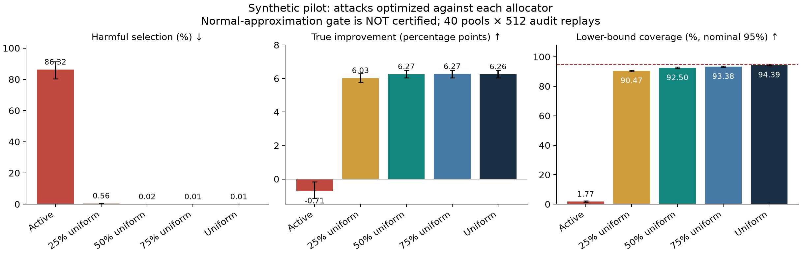

# ML security project: when attacks redirect verification

A **small, reproducible CPU experiment** on synthetic judge scores and audit priorities. This is a mechanism study for the proposed project *Selection-Aware Attacks on LLM Judges: Reliable Model Choice with Limited Verification*.

**Measured result:** manipulating both the judge score and the audit priority can make a naive normal-approximation selection rule fail badly. Simple uniform auditing already works well in this setting. This is **not** a new certified defense, a reproduction of published active-inference algorithms, or an experiment on real LLMs.

The [earlier poisoned-logs pilot](https://github.com/Jamil997/poisoned-logs-prior-pilot) is a separate historical snapshot.

## What we actually ran

- 40 independently generated pools, seeds **12000–12039**, each with **1,024 prompts** and three frozen configurations: baseline, better candidate, worse candidate.
- **512 independent audit replays per pool**: 20,480 decisions per method/condition. These are 40 datasets, not 20,480 independent datasets.
- **10% corruption budget**: up to 102 prompt rows. Only the worse candidate's proxy score and a row's untrusted audit-priority signal can change. Gold labels stay fixed.
- **20% expected audit fraction**, equal across audit allocators. One audited prompt reveals all three labels, so expected test cost is **614.4 gold labels per replay**. Actual counts fluctuate; draws are not truncated.
- Five allocations: uncertainty-based active allocation, uniform allocation, and uniform mixtures of 25%, 50%, and 75%.
- No attack, random joint edits, scores-only, priorities-only, joint selection attack, and joint utility-loss attack. The four factorial cells share the same payload within each defender.
- Each adaptive search evaluates **60 allowed payloads**, using 64 search-only audit replays and predictions learned from **2,048 independent calibration prompts**. The attacker receives 6,144 synthetic training labels, reported separately from defender test audits. It never receives evaluation gold labels or evaluation audit coins.
- Separate point-estimate, normal-approximation, and conservative Bernstein gates. The last has a valid fixed-pool bound; the normal gate is explicitly **uncertified**.
- NumPy 2.3.5; the final pilot took **5.09 seconds with two worker processes** on the local ARM64 machine, excluding plotting, installation and tests. This is not a university-server timing measurement.

## Results

The following table is for the **uncertified normal gate**, under attacks optimized separately against each allocator to select the worse candidate. Harm means selecting a candidate more than one percentage point worse than baseline; true improvement is measured in percentage points. Coverage means the fraction of replays in which both lower bounds are below their true finite-pool gains; its nominal target is 95%.

| Audit allocation | Harmful selection | True improvement | Fallback | Lower-bound coverage |
|---|---:|---:|---:|---:|
| Active | 86.318% | −0.714 pp | 0.273% | 1.77% |
| 25% uniform mixture | 0.562% | +6.034 pp | 3.433% | 90.47% |
| 50% uniform mixture | 0.024% | +6.266 pp | 0.200% | 92.50% |
| 75% uniform mixture | 0.010% | +6.274 pp | 0.083% | 93.38% |
| Uniform | 0.015% | +6.262 pp | 0.298% | 94.39% |



**Mechanism ablation:** for the active allocator, applying the same score edits while retaining the clean audit priorities gives 0.005% harmful selection and +6.277 pp improvement. Activating the attacked priorities raises harm by **86.313 percentage points** (paired pool-bootstrap 95% interval: **80.224 to 91.206 pp**). This is a controlled software intervention on the acquisition pathway; it is not a claim about natural mediation in real deployments.

**Concrete witness, seed 12000:** edited rows' average audit probability drops from 0.115293 to 0.000122. They are almost never checked. If one is checked, inverse-probability correction can be enormous. The estimator remains unbiased over the complete audit distribution, but a normal interval estimated from a small realized sample can be grossly overconfident. [witness.json](witness.json) records examples; its truth labels were added afterward by the evaluator.

**The negative result matters:** the valid conservative Bernstein gate selects baseline in **100%** of replays across all tested audit allocators and conditions: zero observed harm, **zero improvement**. It does not solve the usefulness problem. The 50% mixture also has **no demonstrated utility advantage over uniform auditing**: its improvement difference is only +0.0045 pp (paired pool-bootstrap interval −0.0049 to +0.0139 pp). There is no established Pareto improvement or new-method novelty here. Low observed harm does not turn the normal approximation into a certificate.

Intervals in [summary.json](summary.json) resample the **40 pools**, preserving paired comparisons. They are descriptive uncertainty estimates for this data-generating process and attack family, not deployment guarantees. An all-zero bootstrap interval is not proof of zero population risk. The headline is the planned harm objective; a separately optimized utility-loss objective is also included in the raw results.

## How the synthetic world works

1. A prompt is easy (80%) or hard (20%). Baseline, good, and bad correctness probabilities are `[0.62, 0.68, 0.60]`, minus 0.18 on hard prompts. A shared uniform draw produces correlated, paired correctness labels. This deliberately simple, monotone setup is a limitation.
2. A synthetic judge flips correctness with probability 0.01 on easy prompts and 0.25 on hard prompts. Most flip noise is shared across candidates, with 20% independently drawn. Proxy scores are 0.02 or 0.98.
3. The clean audit-priority feature is `sqrt(error_rate + 0.002)`. It is an informative synthetic feature, not a fitted published acquisition model. The active allocator uses water filling: `p_i = min(1, lambda * priority_i)`, with `lambda` chosen for mean probability 0.20.
4. A mixture uses `p_mix = eta * 0.20 + (1-eta) * p_active`. Uniform auditing is `eta=1`; the unprotected allocator is `eta=0`. Tiny positive probabilities are allowed for that vulnerable baseline.
5. Attacks can set one candidate's selected proxy scores to 0.75, 0.9, or 1.0 and multiply selected priorities by 0.001, 0.03, 0.3, 1, or 10. Candidate row sets use only visible proxy scores, group, and random rankings. The 1/1000 multiplier is an intentionally strong capability: a real text attack has **not** been shown to achieve it.
6. A calibration-based surrogate evaluates candidate payloads against the exact defender's normal gate. Final measurements use fresh private audit coins and evaluator-only truth.

Let `d_ij` be candidate-minus-baseline truth, `s_ij` the analogous proxy contrast, and `A_i` the audit indicator. We use the established augmented inverse-probability estimator:

$$\widehat\Delta_j=\frac1N\sum_i\left[s_{ij}+\frac{A_i}{p_i}(d_{ij}-s_{ij})\right].$$

For fixed scores and private independent audit coins its expectation is the true finite-pool gain, regardless of attack. Its exact design variance is

$$\operatorname{Var}(\widehat\Delta_j)=\frac1{N^2}\sum_i(p_i^{-1}-1)(d_{ij}-s_{ij})^2.$$

The normal gate plugs an unbiased variance estimator into a Bonferroni-adjusted normal lower bound. **Unbiased variance estimation does not guarantee interval coverage**, especially when rare, enormous corrections dominate the distribution. The Bernstein reference uses bounded residuals and a simultaneous union bound. See `bounds()` in [experiment.py](experiment.py). The code records theoretical variance and Monte Carlo variance separately; short replays may miss rare tails.

## Reproduce

Python 3.10+ recommended. No GPU, API credentials, or SciPy required.

```bash
python -m venv .venv
source .venv/bin/activate
python -m pip install -r requirements.txt
python -m unittest -v test_experiment.py
python experiment.py --config config_pilot.json --workers 2 --out results/reproduction
python analyze.py --results results/reproduction
```

Output directories must be new, preventing accidental result overwrites. Exact numerical replication was checked for seeds 12000 and 12001 between serial and two-worker execution. Five tests cover exhaustive small-pool unbiasedness/variance, audit-budget accounting, full-audit recovery, attack validity, and search independence from hidden test truth. NumPy is the only runtime dependency for simulation; Matplotlib is used for plotting. Cross-platform floating-point ties can differ; pin NumPy 2.3.5 for closest reproduction.

The frozen published snapshot is at repository root: [seed_metrics.csv](seed_metrics.csv), [metadata.json](metadata.json), [summary.json](summary.json), [witness.json](witness.json), and the plot. Regenerate its summary with `python analyze.py --results .`. `metadata.json` contains the experiment-code SHA-256 and executed configuration. `config_pilot.json` and `config_scale.json` are inputs, not claimed preregistrations with an independent timestamp.

## Extending on a bigger CPU machine

**More CPU cores increase the number of independent seeds we can run concurrently. They do not resolve the theoretical or novelty gap.** The simulator already parallelizes whole pools with `ProcessPoolExecutor`; results are seeded independently of worker scheduling.

The supplied, **not yet executed**, scale configuration increases to 8,192 prompts, 200 independent pools, 2,048 audit replays, 120 attack candidates, and 128 search replays. Start with 8 workers and at least 16–32 GB RAM; budget roughly 1–2 GB per worker conservatively and measure peak memory. Increase to 16 workers only after checking memory and throughput. The largest matrix of audit uniforms alone uses `8 * prompts * replays` bytes (128 MiB per worker in this scale configuration); transient matrix operations need more. Much larger pools require chunked replay evaluation, which this version does not implement.

```bash
# Measure two full-size pools before scheduling the 200-pool job.
python experiment.py --config config_scale.json --seeds 2 --workers 2 --out results/scale-timing

# Main CPU run; choose the worker count to match your allocation.
bash run_large_cpu.sh 8 results/scale-main
```

Estimate server runtime from the measured per-pool times in `metadata.json`: `mean(pool_seconds) * number_of_pools / workers`, then allow extra time for contention and plotting. Do not extrapolate the 5.09-second laptop result as a server guarantee. Set BLAS thread counts to one (the script does this) to avoid every worker launching its own large thread pool.

For a university SLURM allocation, activate your environment, request e.g. 8 CPU cores and 32 GB RAM, and run `bash run_large_cpu.sh "$SLURM_CPUS_PER_TASK" results/scale-main`. Queue, account, and environment setup depend on the university cluster. No cluster job has been submitted.

### Scientific expansion, in order

1. **Repair inference and test strong competitors.** Implement variance-adaptive valid intervals and actual robust-active-inference / best-arm-auditing baselines. Separate reproduction from adaptations. Uniform auditing is mandatory. Abandon a new-defense claim if an existing procedure solves this setting.
2. **Change the simulator, not just its size.** Sweep corruption fractions 1/5/10/20%, audit fractions 5/10/20/40%, gaps 1/3/6 pp, numbers of candidates, error heterogeneity, and less extreme priority multipliers. Add non-monotone candidate outcomes and calibration shift. Preserve all cells, including failures. These sweeps require separate config/code changes; `config_scale.json` currently scales only the same primary setting.
3. **Strengthen the attacker.** Increase candidate-family diversity and optimization effort; add per-row heterogeneous edits and attacks against new confidence procedures. This finite search is not a globally optimal attack.
4. **Evaluate useful operating points.** Require valid coverage first, then compare harm, retained improvement, fallback, and both test-label and compute cost. Use pool-level uncertainty and prespecified comparisons; do not select a favorable mixture after inspecting test data and call it a discovery.
5. **Move to real judge outputs.** Cache outputs of 7B/8B/14B judges on the university 48–80 GB GPU, implement answer-preserving text attacks, and measure whether they actually change acquisition scores as assumed here. CPU workers then reuse those cached outputs for audits. A bigger CPU alone does not supply evidence about real LLM attacks.

## Related work and attribution

The correction estimator and uniform mixtures are existing ideas, not claimed contributions of this repository. The pilot does **not** implement the full proposed minimax allocator or reproduce these methods:

- [Active Statistical Inference, ICML 2024](https://proceedings.mlr.press/v235/zrnic24a.html)
- [Robust Sampling for Active Statistical Inference, NeurIPS 2025](https://arxiv.org/abs/2511.08991)
- [Best Arm Identification with LLM Judges and Limited Human Audits, 2026 preprint](https://arxiv.org/abs/2601.21471)
- [Causal Judge Evaluation](https://arxiv.org/abs/2512.11150)
- [JudgeDeceiver, CCS 2024](https://arxiv.org/abs/2403.17710)
- [Debate Training Reduces Reward Hacking in RLAIF, 2026 preprint](https://arxiv.org/abs/2608.17776)

## Ethics and current status

Only locally generated numerical data are attacked. There are no live services, real user data, stolen credentials, or deployed exploits. Future real-model tests should remain in controlled environments; report any newly discovered deployed vulnerability privately before publishing operational details.

Completed: synthetic simulator, finite adaptive search, five audit allocations, three gates, mechanism ablations, CPU parallelization, measured pilot, tests, and reproducible results. Outstanding: useful valid intervals, published strong-baseline replications, the proposed minimax defense, stronger adversaries, and real-LLM evidence. The proposal PDF is distributed separately; this repository contains code, documentation, and experimental data.
