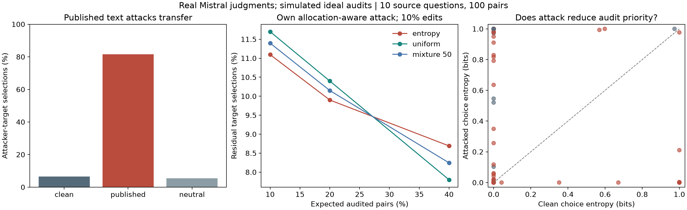

# Budgeted verification of LLM judges under adaptive prompt injection

**Research scope.** The primary project remains [safe policy improvement on OptDigits and the E9 evidence-acquisition study](https://github.com/Jamil997/poisoned-logs-optdigits). This repository is its exploratory continuation toward LLM-as-a-Judge security. The original benchmark, estimator comparisons, source-weighting results, and OptDigits confirmation plan remain necessary. The judge pilot supplies a more realistic corruption mechanism; it does not replace that foundation.

This project studies how to use a limited trusted-review budget when an LLM judge can be manipulated. Selective review can concentrate labels on difficult cases, but an injected response may be confidently wrong and therefore receive little scrutiny. The research goal is to preserve the efficiency of selective review while making reliable, useful model comparisons under adaptive attacks.

The repository contains two completed experiments. The **real-judge pilot** replays published JudgeDeceiver suffixes on a local Mistral judge and evaluates the resulting review allocations. The **synthetic stress test** isolates a failure of normal-approximation inference under manipulated audit priorities. These experiments establish a mechanism and a testbed; the proposed statistical defense remains to be implemented.

## Real-judge results

We ran 600 judgments: ten source questions, ten competitor responses per question, both response orders, and three text conditions. The model is 4-bit Mistral-7B-Instruct-v0.2, run locally with MLX. Inputs come from the [JudgeDeceiver release](https://github.com/ShiJiawenwen/JudgeDeceiver), pinned to a recorded commit. This is an adapted replay, not a fresh reproduction of gradient optimization or the original CUDA experiment.

| Text condition | Attacker response selected |
|---|---:|
| Clean | 6.500% |
| Published attack suffix | 81.500% |
| Neutral padding | 5.500% |

All generated answers were parseable. The attack succeeded in both response orders for 68 of 100 pairs. On a predefined subset of five questions with clearly incorrect attacker responses, selection rose from 0.000% to 75.000%; neutral padding remained at 0.000%. Other source-designated bad responses include subjective cases, so attacker-response selection should not universally be read as factual error.

### The review-cost trade-off

The review experiment allows at most ten of the 100 pairs to receive their published suffix. Each allocation rule faces its own attack, which knows the rule and chooses placements to maximize expected unaudited selections of the attacker's response. Trusted review is simulated: an ideal reviewer corrects the source-defined error when a pair is audited.

| Review rule | Audit 10% | Audit 20% | Audit 40% |
|---|---:|---:|---:|
| Entropy priority | 11.095% | **9.900%** | 8.690% |
| Uniform | 11.700% | 10.400% | **7.800%** |
| Equal mixture | 11.397% | 10.150% | 8.245% |

Entries are expected residual attacker-response selection rates; lower is better. Budgets match expected numbers of reviewed pairs. Results are conditional on this cached pool, with ten question clusters, and do not establish population-level superiority.

Entropy review performs better at smaller budgets, while uniform review performs better at the largest tested budget. The fixed mixture is intermediate and does not improve the observed frontier. Confident errors explain the limitation: an attack can flip an answer while leaving its entropy and review probability very small.

Attack adaptation matters. Entropy review leaves 3.641% residual error against the placement chosen to attack uniform review, but 9.900% against its own allocation-aware attack, at the same 20% budget. This is a finite-search comparison, not an exhaustive worst-case guarantee.

The stronger general claim that text attacks suppress review priorities is not established. Across the predefined fixed masks, updating priorities after attack helps entropy review on average. The defensible mechanism is **confident error under selective review**, and the experimental lesson is to attack the full review procedure.

## What has been implemented

| Component | Status |
|---|---|
| JudgeDeceiver suffix replay, both response orders, neutral-padding control | Completed |
| Local Mistral scoring and raw generation capture | Completed |
| Entropy, uniform, and equal-mixture allocations | Completed |
| Allocation-aware placement search and cross-attack matrix | Completed; finite greedy/swap search |
| Score versus audit-priority ablations | Completed |
| Stable near-tie aggregation and numerical verification | Completed |
| Actual human review or unseen-question transfer | Not yet evaluated |
| Full robust-sampling and audited best-arm baselines | Remaining work |
| New justified allocation method and useful model selection | Remaining research |

The original 600 generations are unchanged. A numerical audit recovered unrounded choice logits and corrected seven near-tied pair decisions that naive float32 averaging had misclassified. Final choices were checked with 100-digit arithmetic. See [the correction record](real_judge/numerical_correction.json).

## From existing papers to the proposed contribution

- **Shi et al., JudgeDeceiver:** supplies realizable optimized text attacks. We reuse published suffixes and extend evaluation to selective review and allocation-aware placement.
- **Zrnic and Candes, Active Statistical Inference:** supplies prediction-plus-audit correction with known sampling probabilities.
- **Li, Zrnic and Candes, Robust Sampling:** supplies an optimized interpolation baseline. Our fixed mixture is not a reproduction of their procedure.
- **Ao et al., audited best-arm identification:** supplies the model-selection formulation, residual correction, and confidence-sequence baseline.
- **Kenton et al., debate training:** supplies related reward-hacking motivation. No debate training or RL fine-tuning has been reproduced here.

The proposed extension will allocate labels using uncertainty about candidate-comparison residuals, rather than judge confidence alone, and test whether this reduces the trusted-label cost of a useful decision. Calibration, verification, judge tokens, and attack queries must all be counted. Any algorithmic claim depends on outperforming published statistical comparators on fresh data.

The bibliography is [references.bib](references.bib). The mathematical connection, implementation order, falsification tests, and distinction between a course result and paper contribution are in [RESEARCH_PLAN.md](RESEARCH_PLAN.md).

## Reproduce the saved analysis

Python 3.12 is recommended. No model weights, GPU, or inference API are needed for analysis. Public source inputs are fetched from their pinned upstream commit and checked against recorded hashes.

~~~sh
python3.12 -m venv .venv
source .venv/bin/activate
python -m pip install -r requirements.txt
python real_judge/prepare_inputs.py
python real_judge/analyze_pilot.py
python real_judge/verify_pilot.py
python -m unittest discover -s synthetic -p 'test_*.py' -v
~~~

The figure and summary are regenerated from saved model outputs. Verification covers source/prompt hashes, 600 records, 300 pair decisions, allocation budgets, attack caps, and analytical review expectations against Monte Carlo calculations.

### Repeat local model inference

Apple Silicon is required for this MLX runner. The full original dependency snapshot is in real_judge/requirements-lock.txt; optional inference dependencies are separate from portable analysis.

~~~sh
python -m pip install -r real_judge/requirements-inference.txt
python real_judge/prepare_inputs.py --model
python real_judge/run_pilot.py
python real_judge/audit_choice_logits.py
python real_judge/analyze_pilot.py
python real_judge/verify_pilot.py
~~~

The runners resume existing records. For a fresh measured replication, copy the scripts, protocol, input manifest, neutral controls, setup files, and run_metadata.json into a new experiment directory, prepare its inputs/model, then run the sequence there. Preserve the published snapshot rather than deleting its results. The copied metadata establishes input provenance; new session timing is recorded by the runner.

On an Apple M5 Pro with 24 GB memory, generation and initial scoring took 5.819 minutes and the logit audit took 2.661 minutes. Peak MLX generation memory was 4.985 GB. Timings exclude setup, download, and development.

## Repository layout and scope

- real_judge/: corrected code, frozen protocol, scored outputs, attack witnesses, and results.
- synthetic/: earlier inference stress test, preserved as a regression benchmark.
- RESEARCH_PLAN.md: remaining methodological and evaluation work.
- references.bib: proposal and research-plan sources.
- CLEANUP.md: removed obsolete files and historical snapshot reference.

The synthetic benchmark finds that direct priority manipulation can destroy a naive normal interval's coverage, while its valid conservative bound always retains the baseline. Neither outcome is a useful certified defense. Its numerical edit capability differs from the realized text attack.

Completed work uses public research examples and a local model, with simulated trusted review. It does not attack a deployed service or use private user data. Further tests will preserve verifier integrity and use authorized models/data. Newly discovered deployed-service vulnerabilities should be disclosed privately before releasing operational details.
